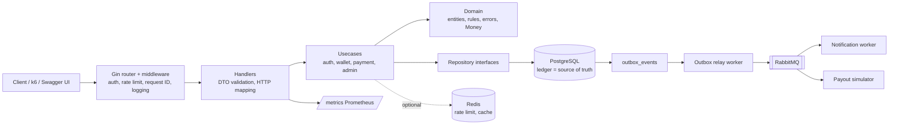
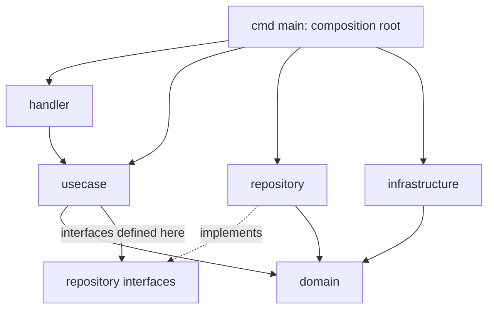
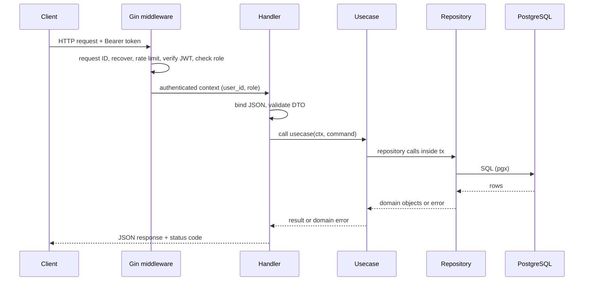
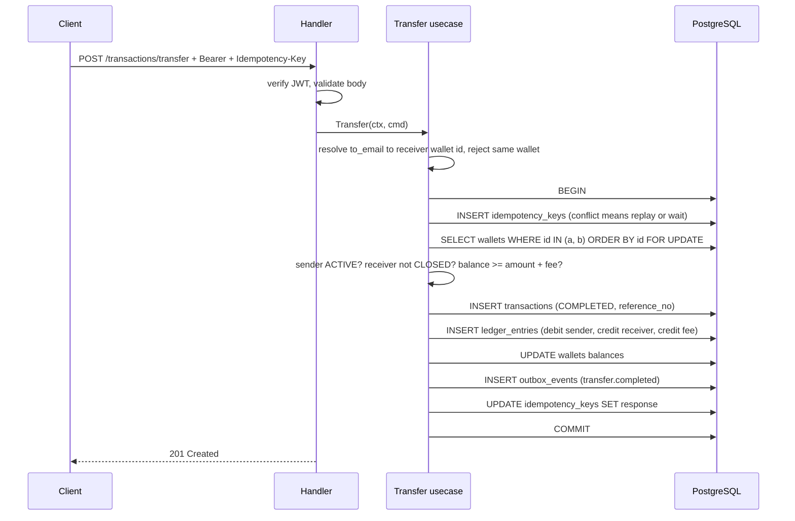
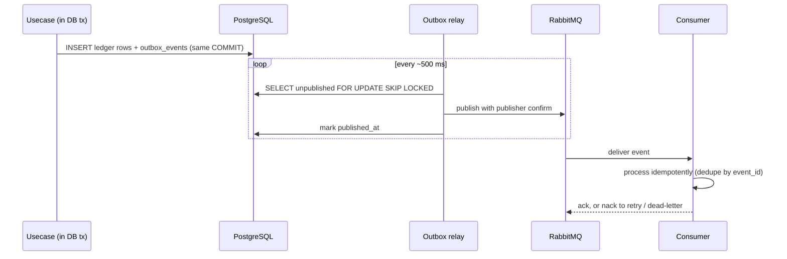
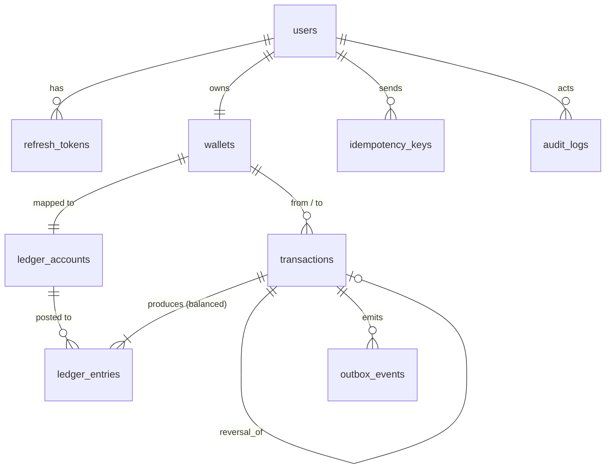
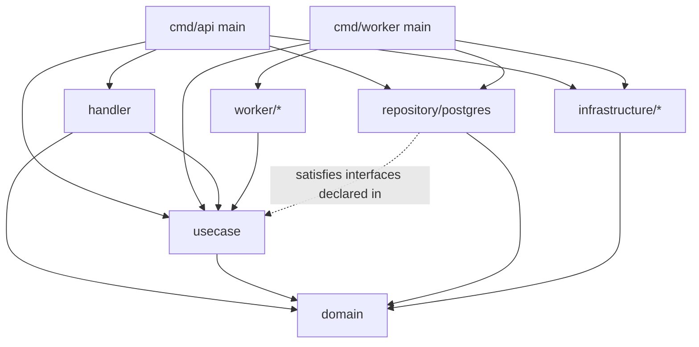

[Home](README.md) | **Architecture** | [Business logic](business-logic.md) | [Step by step](step-by-step.md)

---

# Architecture

How the system is built: components, layers, data model, and the technical flows. For the *why* behind the money rules, read [Business logic](business-logic.md). For the build order, read [Step by step](step-by-step.md).

Contents: 1 System overview, 2 Components, 3 Layering rules, 4 Request lifecycle, 5 Authentication, 6 Transfer flow, 7 Async processing, 8 Error handling, 9 Database, 10 Folder structure, 11 Key decisions, 12 Security checklist.

---

## 1. System overview

A **modular monolith**: one Go binary for the API, a second entrypoint for workers, strict internal module boundaries. PostgreSQL is the only source of truth. Redis and RabbitMQ help but can fail without corrupting money.



## 2. Components

| Component | Responsibility | Needed in v1? |
| --- | --- | --- |
| HTTP layer (Gin, middleware) | Routing, JWT check, RBAC, rate limit, request ID, recovery, access log | Yes |
| Handler | Parse and validate DTOs, call one usecase, map result or error to HTTP. No business logic | Yes |
| Usecase | Orchestrates one business operation, owns the DB transaction boundary | Yes |
| Domain | Entities, `Money`, invariants, sentinel errors. Pure Go | Yes |
| Repository | All SQL via pgx; joins a transaction passed through context | Yes |
| PostgreSQL | Ledger, transactions, idempotency keys, outbox | Yes |
| Redis | Rate limiting; optional balance read cache. Never authoritative | Rate limit yes, cache later |
| RabbitMQ | Notifications and simulated payouts off the request path | Phase 10 |
| Outbox relay | Publishes `outbox_events` to RabbitMQ | Phase 10 |
| Workers | Notification, payout simulator, expired-key cleanup | Phase 10+ |

Rule of thumb: add a component only when a requirement forces it. Phases 1 to 8 need only Go and PostgreSQL.

## 3. Layering rules



- Dependencies point **inward** to `domain`, which imports nothing from the project.
- Interfaces are declared by the **consumer** (the usecase package). This avoids import cycles.
- Only `cmd/*/main.go` wires concrete types together, by hand (constructor injection, no DI framework, no globals).

## 4. Request lifecycle



## 5. Authentication and authorization

```mermaid
sequenceDiagram
  participant C as Client
  participant A as API
  participant DB as PostgreSQL
  C->>A: POST /auth/login (email, password)
  A->>DB: load user by email
  A->>A: verify Argon2id hash
  A->>A: sign access JWT (15 min), create random refresh token
  A->>DB: store SHA-256(refresh token), family_id, expires_at
  A-->>C: access token + refresh token
  C->>A: GET /wallets/me (Bearer access)
  A->>A: verify signature, exp, read user_id + role
  A-->>C: 200
  C->>A: POST /auth/refresh (refresh token)
  A->>DB: find hash; if revoked or reused, revoke whole family
  A->>DB: revoke old, insert new token (rotation)
  A-->>C: new access + new refresh token
```

Authentication = who are you (JWT). Authorization = what may you do (role middleware on `/admin/*`, ownership checks in usecases).

## 6. Transfer flow (the one to master)



Failure cases:

| Scenario | Behavior |
| --- | --- |
| Insufficient funds | Detected under lock, rollback, `422 INSUFFICIENT_FUNDS` |
| Recipient missing | `404 WALLET_NOT_FOUND`, rollback |
| Sender equals recipient | Rejected before `BEGIN`; DB `CHECK` as backstop |
| Two requests spend same balance | Second waits on lock, re-reads lower balance, fails if short |
| DB fails mid-way | Nothing committed; client retries with same key |
| Timeout after commit | Retry with same key returns stored response (`Idempotent-Replayed: true`) |
| Deadlock / serialization error | Usecase retries whole transaction up to 3 times with jitter |
| Sender wallet frozen | `403 WALLET_FROZEN` (receiving into a frozen wallet is allowed) |

Concurrency summary: locks taken in ascending wallet id, in one statement; isolation level READ COMMITTED plus explicit row locks; `CHECK (balance >= 0)` as last-resort guard.

## 7. Asynchronous processing (transactional outbox)



Why not publish inside the transaction: the commit can fail after the message is sent (phantom event), or the process can crash before the publish (lost event). The outbox makes the event part of the same atomic commit. Delivery is at-least-once, so consumers must be idempotent.

## 8. Error handling

- Domain errors are sentinel values (`ErrInsufficientFunds`, `ErrWalletFrozen`, `ErrSameWallet`, `ErrWalletNotFound`, `ErrIdempotencyConflict`).
- Repositories wrap errors with context (`%w`) and translate pgx codes: `23505` unique violation, `40001` serialization failure, `40P01` deadlock.
- The usecase decides what is retryable and retries the whole transaction, bounded.
- Handlers map errors with `errors.Is` to an HTTP status and stable `code`. Unknown errors return `500` and are logged with the request id, never leaked.

Uniform error body:

```json
{ "error": { "code": "INSUFFICIENT_FUNDS", "message": "Balance is too low", "details": [] }, "meta": { "request_id": "c1b2..." } }
```

## 9. Database

All money is `BIGINT` whole rupiah (`type Money int64` in Go). Never floats.



| Table | Purpose | Key constraints | Main indexes |
| --- | --- | --- | --- |
| `users` | Identity, role | unique `lower(email)`; role in USER, ADMIN | email |
| `refresh_tokens` | Hashed tokens for rotation and revocation | unique `token_hash`; `family_id` | `user_id` |
| `wallets` | Status and cached balance | `user_id` unique; `balance >= 0`; currency IDR | unique wallet_number |
| `ledger_accounts` | Every debit/credit target, user or system | `wallet_id` unique, required iff USER_WALLET | wallet_id |
| `transactions` | Business record and state | unique `reference_no`; `amount > 0`; unique `reversal_of_id`; `from <> to` | `(from_wallet_id, created_at)`, `(to_wallet_id, created_at)`, `(status, created_at)` |
| `ledger_entries` | Immutable double-entry rows | `amount > 0`; direction check; balanced trigger; no update/delete trigger | `(ledger_account_id, id)`, `(transaction_id)` |
| `idempotency_keys` | Replay protection | unique `(user_id, key)`; request hash | `expires_at` |
| `audit_logs` | Append-only action log | JSONB metadata | `(entity_type, entity_id)`, `(actor_user_id, created_at)` |
| `outbox_events` | Events to publish | `published_at` null until sent | partial index where unpublished |

### Schema draft (refined as migrations in Phase 2)

```sql
CREATE TABLE users (
  id UUID PRIMARY KEY DEFAULT gen_random_uuid(),
  email TEXT NOT NULL,
  password_hash TEXT NOT NULL,
  full_name TEXT NOT NULL,
  role TEXT NOT NULL DEFAULT 'USER' CHECK (role IN ('USER','ADMIN')),
  is_active BOOLEAN NOT NULL DEFAULT TRUE,
  created_at TIMESTAMPTZ NOT NULL DEFAULT now(),
  updated_at TIMESTAMPTZ NOT NULL DEFAULT now()
);
CREATE UNIQUE INDEX users_email_uk ON users (lower(email));

CREATE TABLE refresh_tokens (
  id UUID PRIMARY KEY DEFAULT gen_random_uuid(),
  user_id UUID NOT NULL REFERENCES users(id),
  family_id UUID NOT NULL,
  token_hash BYTEA NOT NULL UNIQUE,
  expires_at TIMESTAMPTZ NOT NULL,
  revoked_at TIMESTAMPTZ,
  replaced_by UUID REFERENCES refresh_tokens(id),
  created_at TIMESTAMPTZ NOT NULL DEFAULT now()
);
CREATE INDEX refresh_tokens_user_idx ON refresh_tokens (user_id);

CREATE TABLE wallets (
  id UUID PRIMARY KEY DEFAULT gen_random_uuid(),
  user_id UUID NOT NULL UNIQUE REFERENCES users(id),
  wallet_number TEXT NOT NULL UNIQUE,
  currency CHAR(3) NOT NULL DEFAULT 'IDR' CHECK (currency = 'IDR'),
  status TEXT NOT NULL DEFAULT 'ACTIVE' CHECK (status IN ('ACTIVE','FROZEN','CLOSED')),
  balance BIGINT NOT NULL DEFAULT 0 CHECK (balance >= 0),
  created_at TIMESTAMPTZ NOT NULL DEFAULT now(),
  updated_at TIMESTAMPTZ NOT NULL DEFAULT now()
);

CREATE TABLE ledger_accounts (
  id UUID PRIMARY KEY DEFAULT gen_random_uuid(),
  account_type TEXT NOT NULL CHECK (account_type IN
    ('USER_WALLET','SYSTEM_CASH','PAYOUT_CLEARING','FEE_REVENUE')),
  wallet_id UUID UNIQUE REFERENCES wallets(id),
  currency CHAR(3) NOT NULL DEFAULT 'IDR',
  created_at TIMESTAMPTZ NOT NULL DEFAULT now(),
  CHECK ((account_type = 'USER_WALLET') = (wallet_id IS NOT NULL))
);

CREATE TABLE transactions (
  id UUID PRIMARY KEY DEFAULT gen_random_uuid(),
  reference_no TEXT NOT NULL UNIQUE,
  type TEXT NOT NULL CHECK (type IN ('DEPOSIT','WITHDRAWAL','TRANSFER','REVERSAL')),
  status TEXT NOT NULL CHECK (status IN ('PENDING','COMPLETED','FAILED','REVERSED')),
  amount BIGINT NOT NULL CHECK (amount > 0),
  fee BIGINT NOT NULL DEFAULT 0 CHECK (fee >= 0),
  currency CHAR(3) NOT NULL DEFAULT 'IDR',
  from_wallet_id UUID REFERENCES wallets(id),
  to_wallet_id UUID REFERENCES wallets(id),
  reversal_of_id UUID UNIQUE REFERENCES transactions(id),
  initiated_by UUID NOT NULL REFERENCES users(id),
  failure_reason TEXT,
  created_at TIMESTAMPTZ NOT NULL DEFAULT now(),
  completed_at TIMESTAMPTZ,
  CHECK (from_wallet_id IS DISTINCT FROM to_wallet_id)
);
CREATE INDEX tx_from_idx ON transactions (from_wallet_id, created_at DESC);
CREATE INDEX tx_to_idx ON transactions (to_wallet_id, created_at DESC);
CREATE INDEX tx_status_idx ON transactions (status, created_at DESC);

CREATE TABLE ledger_entries (
  id BIGINT GENERATED ALWAYS AS IDENTITY PRIMARY KEY,
  transaction_id UUID NOT NULL REFERENCES transactions(id),
  ledger_account_id UUID NOT NULL REFERENCES ledger_accounts(id),
  direction TEXT NOT NULL CHECK (direction IN ('DEBIT','CREDIT')),
  amount BIGINT NOT NULL CHECK (amount > 0),
  created_at TIMESTAMPTZ NOT NULL DEFAULT now()
);
CREATE INDEX entries_account_idx ON ledger_entries (ledger_account_id, id DESC);
CREATE INDEX entries_tx_idx ON ledger_entries (transaction_id);

-- Immutability: nobody edits or deletes ledger rows.
CREATE FUNCTION forbid_ledger_mutation() RETURNS trigger AS $$
BEGIN RAISE EXCEPTION 'ledger_entries is append-only'; END $$ LANGUAGE plpgsql;
CREATE TRIGGER ledger_entries_immutable
  BEFORE UPDATE OR DELETE ON ledger_entries
  FOR EACH ROW EXECUTE FUNCTION forbid_ledger_mutation();

-- Balance rule: checked at COMMIT, after all entries of a transaction exist.
CREATE FUNCTION assert_transaction_balanced() RETURNS trigger AS $$
DECLARE d BIGINT; c BIGINT;
BEGIN
  SELECT COALESCE(SUM(amount) FILTER (WHERE direction = 'DEBIT'), 0),
         COALESCE(SUM(amount) FILTER (WHERE direction = 'CREDIT'), 0)
    INTO d, c FROM ledger_entries WHERE transaction_id = NEW.transaction_id;
  IF d <> c THEN
    RAISE EXCEPTION 'unbalanced transaction %: debit % credit %', NEW.transaction_id, d, c;
  END IF;
  RETURN NULL;
END $$ LANGUAGE plpgsql;
CREATE CONSTRAINT TRIGGER ledger_entries_balanced
  AFTER INSERT ON ledger_entries DEFERRABLE INITIALLY DEFERRED
  FOR EACH ROW EXECUTE FUNCTION assert_transaction_balanced();

CREATE TABLE idempotency_keys (
  id UUID PRIMARY KEY DEFAULT gen_random_uuid(),
  user_id UUID NOT NULL REFERENCES users(id),
  key TEXT NOT NULL,
  endpoint TEXT NOT NULL,
  request_hash BYTEA NOT NULL,
  response_status INT,
  response_body JSONB,
  transaction_id UUID REFERENCES transactions(id),
  created_at TIMESTAMPTZ NOT NULL DEFAULT now(),
  expires_at TIMESTAMPTZ NOT NULL DEFAULT now() + interval '24 hours',
  UNIQUE (user_id, key)
);
CREATE INDEX idem_expires_idx ON idempotency_keys (expires_at);

CREATE TABLE audit_logs (
  id BIGINT GENERATED ALWAYS AS IDENTITY PRIMARY KEY,
  actor_user_id UUID REFERENCES users(id),
  action TEXT NOT NULL,
  entity_type TEXT NOT NULL,
  entity_id TEXT NOT NULL,
  metadata JSONB NOT NULL DEFAULT '{}',
  request_id TEXT,
  ip_address INET,
  created_at TIMESTAMPTZ NOT NULL DEFAULT now()
);
CREATE INDEX audit_entity_idx ON audit_logs (entity_type, entity_id);
CREATE INDEX audit_actor_idx ON audit_logs (actor_user_id, created_at DESC);

CREATE TABLE outbox_events (
  id UUID PRIMARY KEY DEFAULT gen_random_uuid(),
  aggregate_type TEXT NOT NULL,
  aggregate_id UUID NOT NULL,
  event_type TEXT NOT NULL,
  payload JSONB NOT NULL,
  attempts INT NOT NULL DEFAULT 0,
  created_at TIMESTAMPTZ NOT NULL DEFAULT now(),
  published_at TIMESTAMPTZ
);
CREATE INDEX outbox_unpublished_idx ON outbox_events (created_at) WHERE published_at IS NULL;
```

Seed the three system `ledger_accounts` (`SYSTEM_CASH`, `PAYOUT_CLEARING`, `FEE_REVENUE`) in a migration.

### Useful queries

```sql
-- Derived balance (source of truth)
SELECT COALESCE(SUM(CASE direction WHEN 'CREDIT' THEN amount ELSE -amount END), 0) AS balance
FROM ledger_entries le
JOIN ledger_accounts la ON la.id = le.ledger_account_id
WHERE la.wallet_id = $1;

-- Reconciliation: cached vs derived, must return zero rows
SELECT w.id, w.balance AS cached, d.derived
FROM wallets w
JOIN ledger_accounts la ON la.wallet_id = w.id
CROSS JOIN LATERAL (
  SELECT COALESCE(SUM(CASE direction WHEN 'CREDIT' THEN amount ELSE -amount END), 0) AS derived
  FROM ledger_entries WHERE ledger_account_id = la.id
) d
WHERE w.balance <> d.derived;

-- Every transaction balances, must return zero rows
SELECT transaction_id FROM ledger_entries
GROUP BY transaction_id
HAVING SUM(CASE direction WHEN 'DEBIT' THEN amount ELSE -amount END) <> 0;

-- History, keyset pagination
SELECT id, reference_no, type, status, amount, fee, created_at
FROM transactions
WHERE (from_wallet_id = $1 OR to_wallet_id = $1)
  AND (created_at, id) < ($2, $3)
ORDER BY created_at DESC, id DESC
LIMIT 20;
```

## 10. Folder structure

```text
wallet-system/
  cmd/
    api/main.go              # composition root, HTTP server
    worker/main.go           # outbox relay + consumers
  internal/
    config/
    domain/                  # pure business model, stdlib only
      money/  user/  wallet/  ledger/  transaction/  audit/
      errors.go
    usecase/                 # one package per area; ports.go holds interfaces it needs
      auth/  wallet/  payment/  admin/
    handler/http/
      router.go  dto/  *_handler.go  errors.go
      middleware/            # auth, rbac, ratelimit, requestid, logging, recovery
    repository/postgres/     # pgx implementations, txmanager.go
    infrastructure/
      database/  redis/  rabbitmq/  jwt/  hasher/  logger/  metrics/
    worker/
      outbox/  payout/  notification/  cleanup/
  migrations/
  test/integration/  test/concurrency/
  docs/  scripts/
  docker-compose.yml  Dockerfile  Makefile  .env.example
```



Where things live:

- **DTOs vs entities vs DB rows:** DTOs (JSON and validation tags) in `handler/http/dto`; entities with no tags in `domain`; small private row structs inside the repository.
- **Transaction management:** the usecase decides what is atomic via `TxManager.WithinTx(ctx, fn)` (interface in the usecase, implementation in `repository/postgres`). The transaction travels in the context, so repositories join it automatically.
- **Conventions:** `ctx` first parameter everywhere; wrap errors with `%w`; inject a `Clock`; table-driven tests with testify.

## 11. Key decisions

| Decision | Recommended | Alternative | Why |
| --- | --- | --- | --- |
| Architecture | Modular monolith | Microservices | A transfer must be one ACID transaction; splitting would force sagas |
| Database | PostgreSQL | MySQL | `FOR UPDATE SKIP LOCKED`, deferred constraint triggers, partial indexes, JSONB |
| Data access | pgx + hand-written SQL | GORM | Exact control of locks and transaction scope |
| Balance | Ledger truth + cached balance | Derive each read, or cache only | Fast, auditable, verifiable by reconciliation |
| Idempotency store | PostgreSQL | Redis | Key must commit atomically with the money |
| Processing | Sync money, async side effects | Everything async | Users expect an immediate result; slow steps go behind a queue |
| Broker | RabbitMQ | Kafka | Task queues, ack, retry, dead-letter; Kafka is heavier than needed |
| Concurrency | Pessimistic ordered locks | Optimistic version + retry | Real contention; simple to reason about |
| Isolation | READ COMMITTED + locks | SERIALIZABLE | Fewer aborts; the lock already serializes the critical section |
| Event delivery | Transactional outbox | Publish after commit | No lost or phantom events |
| Money type | BIGINT rupiah | NUMERIC | IDR has no practical minor unit |
| Logging / tests | slog / testcontainers-go | Zap / compose DB | Standard library; throwaway isolated databases |

### Redis and RabbitMQ: what they are for

| Technology | Use for | Not for |
| --- | --- | --- |
| Redis | Rate limiting, brute-force counters, optional short-TTL balance cache, optional token deny-list | Source of truth for balances or idempotency; locks guarding money |
| RabbitMQ | Notifications, simulated payouts, status updates, retry with dead-letter queue | Anything required for ledger correctness |

## 12. Security checklist

- Argon2id passwords with per-user salt; never log them.
- Access JWT 15 minutes; verify `alg`, `exp`, issuer. Refresh token random, hash stored, rotated every use, reuse revokes the family.
- Role middleware on `/admin/*`; ownership checks in usecases; never trust role or user id from the body.
- Parameterised SQL only.
- Rate limit login and email lookup; progressive lockout; masked recipient name.
- Strict DTO validation, body size limit, amount bounds.
- Idempotency keys scoped per user, request-hash check, 24 h expiry.
- No passwords, tokens or auth request bodies in logs.

---

[Home](README.md) | **Architecture** | [Business logic](business-logic.md) | [Step by step](step-by-step.md)
