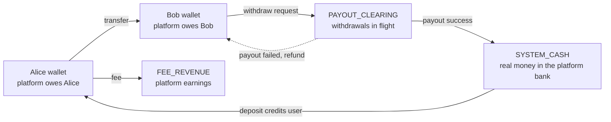
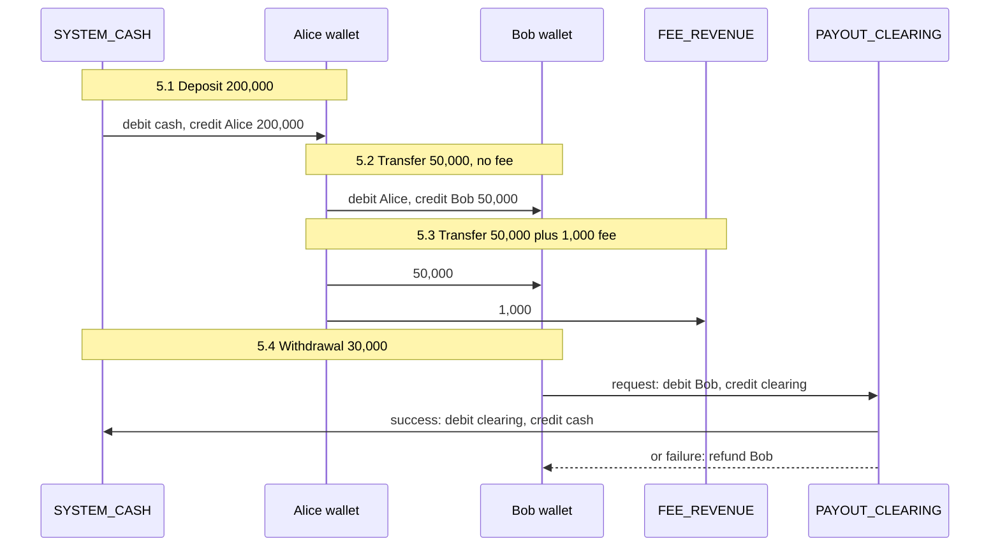
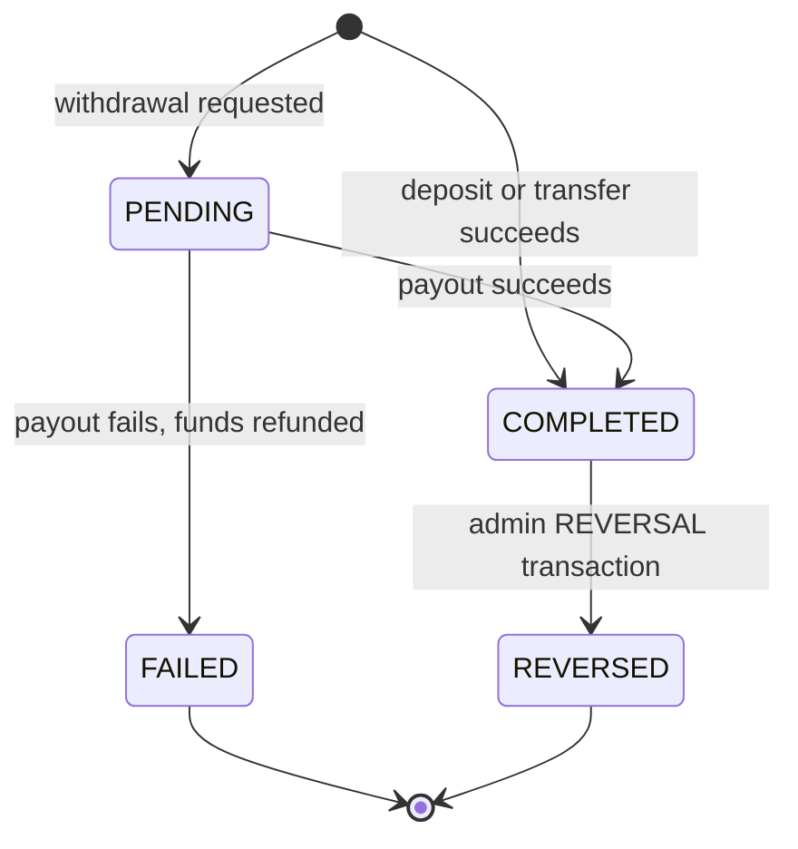
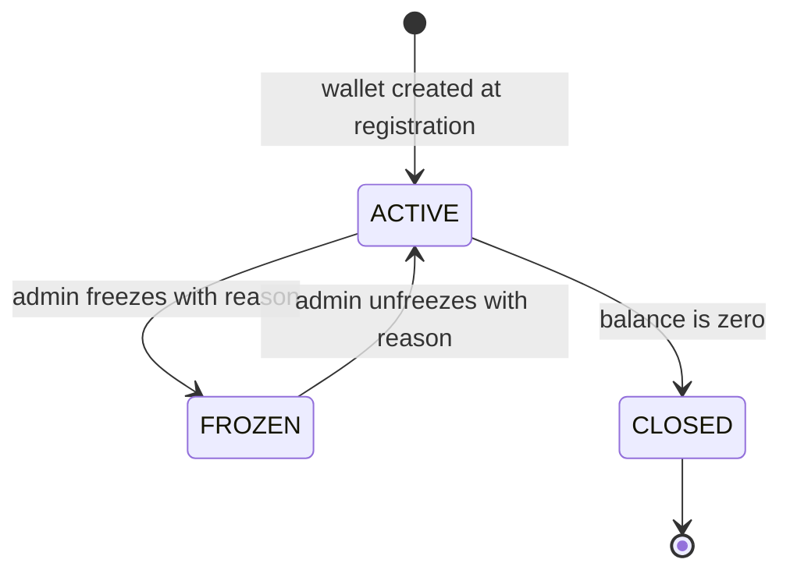
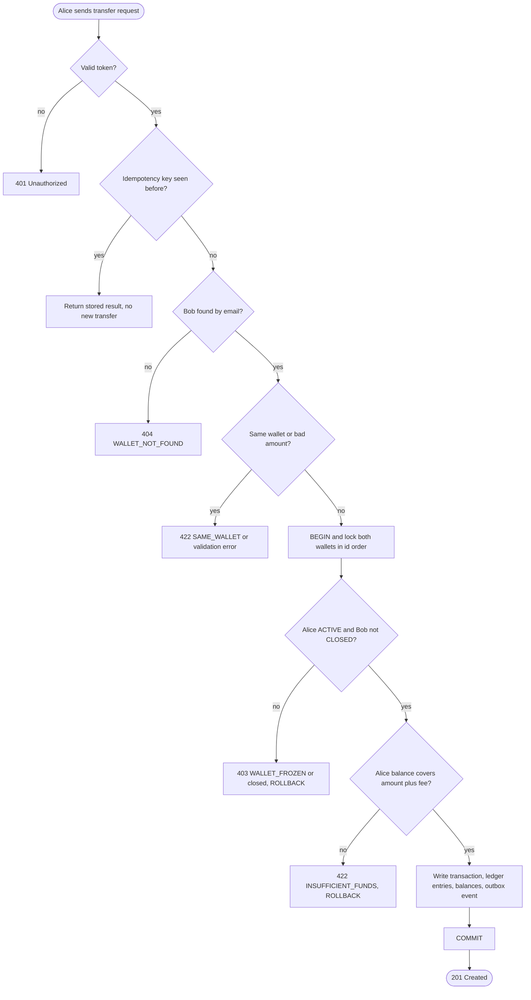
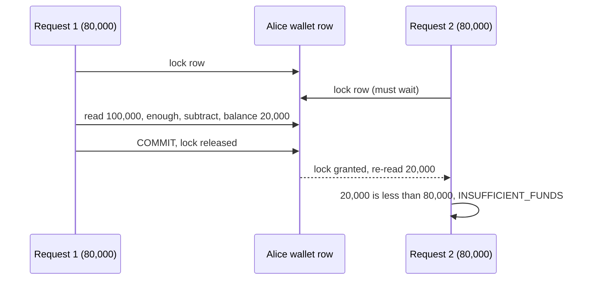
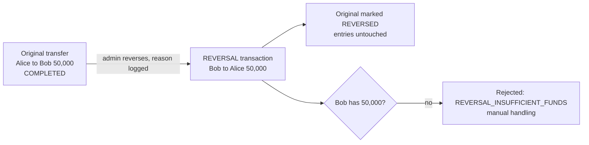
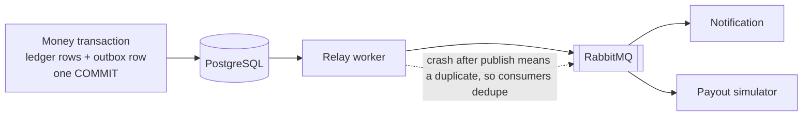

[Home](README.md) | [Architecture](architecture.md) | **Business logic** | [Step by step](step-by-step.md)

---

# Business Logic: How a Digital Wallet Works

This file explains the business behind the wallet system, before any code. If you understand this, the database, API and Go code are just ways of enforcing it.

Decisions already made: currency is IDR (whole rupiah), transfers go by recipient **email**, frozen wallets **can receive but not send**, fees are **zero by default**.

---

## 1. What the product is

A digital wallet is a **stored balance of money inside a platform**. Users put money in (deposit), move it to other users (transfer), and take it back out to a real bank (withdrawal).

The key idea: **the platform holds real money in its own bank account and keeps a record of how much of it belongs to each user.** The wallet balance is not real cash in a drawer. It is a *promise*: "the platform owes this user Rp X".

So three kinds of things exist:

| Thing | Meaning |
| --- | --- |
| Platform's real bank account | Where the actual money sits (we simulate this as `SYSTEM_CASH`) |
| User wallets | What the platform owes each user |
| Platform's own earnings | Fees collected (`FEE_REVENUE`) |

**The golden rule:** the total the platform owes all users must never exceed what it really holds, and no user may ever have a negative balance.

---

## 2. Who uses it

| Actor | Can do |
| --- | --- |
| **User** | Register, log in, see own wallet, deposit, withdraw, transfer to another user by email, see own history |
| **Admin** | View users, wallets and all transactions; freeze/unfreeze wallets; reverse a transaction; read audit logs; monitor failed transactions |
| **System / workers** | Process simulated payouts, send notifications, clean up expired data |

A user can only ever see and act on **their own** wallet. Admins can see everything but every admin action is recorded.

---

## 3. The wallet

Each user has exactly one wallet (IDR). It has a **status**:

| Status | Can receive money | Can send / withdraw | Typical reason |
| --- | --- | --- | --- |
| ACTIVE | Yes | Yes | Normal |
| FROZEN | Yes | **No** | Suspicious activity, dispute, compliance review |
| CLOSED | No | No | Account ended (balance must be zero first) |

Why let a frozen wallet receive? Freezing protects against money *leaving* during an investigation. Blocking incoming money would bounce legitimate payments and complicate things.

**Balance** is always an integer number of rupiah. Never decimals, so there are no rounding mistakes.

---

## 4. Why a ledger instead of just a balance number

The naive way: store `balance = 100000` and change it. Problems:

1. If you subtract from one user and the server crashes before adding to the other, money vanishes.
2. You cannot answer *why* the balance is what it is.
3. Two simultaneous spends can both succeed on the same money.
4. You cannot audit or reverse anything safely.

The fix is **double-entry bookkeeping**, the method accountants have used for centuries:

> Every movement of money is written as entries that **take from one place and put in another**. Total taken always equals total put.

Each entry says: *which account*, *debit or credit*, *how much*.

For a user wallet (money the platform owes them):

- **CREDIT** = balance goes up (money arrives)
- **DEBIT** = balance goes down (money leaves)

> Balance = total credits − total debits

This looks backwards at first. It makes sense from the platform's side: your balance is a debt the platform has to you, and a credit *increases* what is owed.

The ledger is **append-only**. Entries are never edited or deleted. Mistakes are fixed by adding new opposite entries (see Reversal).

We also keep a **cached balance** on the wallet row for speed. It is updated in the same database transaction as the entries, and it must always equal the ledger sum. A check query proves this.

---

## 5. Worked examples

Overview of every example below as one picture. Each arrow is one balanced ledger transaction:

Start: Alice 0, Bob 0.

### 5.1 Deposit (Alice adds Rp 200,000)

The platform receives real money in its bank, then credits Alice.

| Account | Debit | Credit |
| --- | --- | --- |
| `SYSTEM_CASH` (platform bank, asset up) | 200,000 | |
| Alice wallet (platform owes her more) | | 200,000 |

Alice = 200,000. Debits = credits = 200,000.

### 5.2 Transfer (Alice sends Bob Rp 50,000, no fee)

| Account | Debit | Credit |
| --- | --- | --- |
| Alice wallet | 50,000 | |
| Bob wallet | | 50,000 |

Alice = 150,000, Bob = 50,000. No real bank money moved; only the *ownership* changed.

### 5.3 Transfer with a fee (fee = Rp 1,000)

The sender pays amount + fee. The receiver gets the amount. The fee goes to the platform.

| Account | Debit | Credit |
| --- | --- | --- |
| Alice wallet | 51,000 | |
| Bob wallet | | 50,000 |
| `FEE_REVENUE` | | 1,000 |

Debits 51,000 = credits 51,000.

### 5.4 Withdrawal (Bob withdraws Rp 30,000 to his bank)

A real payout takes time and can fail, so it has two steps and a holding account.

Step 1, request: money is taken from Bob immediately so he cannot spend it twice.

| Account | Debit | Credit |
| --- | --- | --- |
| Bob wallet | 30,000 | |
| `PAYOUT_CLEARING` (in flight) | | 30,000 |

Step 2a, payout succeeds: the platform's real bank pays Bob.

| Account | Debit | Credit |
| --- | --- | --- |
| `PAYOUT_CLEARING` | 30,000 | |
| `SYSTEM_CASH` | | 30,000 |

Step 2b, payout fails: give the money back.

| Account | Debit | Credit |
| --- | --- | --- |
| `PAYOUT_CLEARING` | 30,000 | |
| Bob wallet | | 30,000 |

The withdrawal transaction goes `PENDING` → `COMPLETED` or `FAILED`.

---

## 6. Transaction types and states

| Type | Meaning | Initial status |
| --- | --- | --- |
| DEPOSIT | Money in from outside | COMPLETED (simulated; real life: PENDING until bank confirms) |
| WITHDRAWAL | Money out to a bank | PENDING |
| TRANSFER | User to user | COMPLETED |
| REVERSAL | Admin correction of an earlier transaction | COMPLETED |

Allowed status changes (nothing else is allowed):

Wallet status changes are separate and admin-controlled:

Every transaction gets a unique **reference number** (like `TRX-20261111-8F3K2A`) that users and support can quote.

---

## 7. The rules (business invariants)

These must be true at all times. Tests and database constraints enforce them.

1. A wallet balance is never negative.
2. Every transaction's debits equal its credits.
3. Ledger entries are never changed or deleted.
4. A wallet's cached balance equals the sum of its ledger entries.
5. A transfer's sender and receiver are different wallets.
6. Amounts are positive whole rupiah.
7. Only ACTIVE wallets can send or withdraw. ACTIVE and FROZEN can receive. CLOSED can do neither.
8. A transaction can be reversed at most once.
9. The same request (same idempotency key) never moves money twice.
10. Every sensitive admin action leaves an audit record.

---

## 8. Transfer rules, step by step

When Alice asks to send Bob Rp 50,000 using Bob's email:

1. Alice must be logged in (valid access token).
2. The request carries an **idempotency key** (explained below).
3. Find Bob by email, then find his wallet. Not found: reject (`WALLET_NOT_FOUND`).
4. Alice's wallet and Bob's wallet must differ (`SAME_WALLET`).
5. Amount must be positive and within configured min/max.
6. **Lock both wallets** so nobody else changes them mid-transfer.
7. Alice's wallet must be ACTIVE (`WALLET_FROZEN` otherwise). Bob's must not be CLOSED.
8. Alice's balance must cover amount + fee (`INSUFFICIENT_FUNDS`).
9. Write the transaction record and the ledger entries; update both cached balances.
10. Record an event to notify both users later.
11. Commit. Either all of this happened or none of it did.

Steps 3 to 5 are cheap checks done first. Steps 7 and 8 are checked **after** locking, because before the lock the numbers can change under you.

---

## 9. Idempotency: safe retries

Real networks fail. Alice taps "Send", the money moves, but the response is lost. Her app retries. Without protection, Bob gets paid twice.

The fix: every money request includes an `Idempotency-Key` (a random UUID the app creates once per user action).

| Situation | Result |
| --- | --- |
| New key | Process normally and store the result with the key |
| Same key, same request again | Return the stored result; **no** second transfer |
| Same key, different request body | Reject (`422`): the key is being misused |
| Same key while the first is still running | Wait, then return the first result |

Keys are kept 24 hours. The unique reference number on transactions is a second safety net.

---

## 10. Concurrency: two people, same money

Alice has Rp 100,000. She fires two transfers of Rp 80,000 at the same instant (two phones, or a bug).

Without locking: both read "balance 100,000", both pass the check, both subtract. She spends 160,000 she does not have.

With locking: the first request locks Alice's wallet. The second must wait. When the first finishes, balance is 20,000. The second then checks, sees 20,000 < 80,000, and fails with `INSUFFICIENT_FUNDS`. Exactly one succeeds.

**Deadlocks:** if request 1 locks Alice then wants Bob, while request 2 locks Bob then wants Alice, both wait forever. Rule: **always lock wallets in the same order** (for example, lowest wallet id first). Then a cycle is impossible.

---

## 11. Reversals and refunds

A completed transaction is history. Never edit or delete it. To undo one, create a **new** REVERSAL transaction with opposite entries.

Example: reverse the 50,000 transfer from 5.2.

| Account | Debit | Credit |
| --- | --- | --- |
| Bob wallet | 50,000 | |
| Alice wallet | | 50,000 |

The original stays visible, marked REVERSED, and the reversal points back to it. Both are in the audit trail with the admin's name and reason.

Problem case: Bob already spent the money, so reversing would make him negative. Our rule: reject the reversal (`REVERSAL_INSUFFICIENT_FUNDS`) and handle it manually. Real banks open a recovery process or place a hold.

---

## 12. Admin and audit

Admins can: list users and wallets, freeze or unfreeze a wallet (with a reason), view all and failed transactions, reverse a transaction, read audit logs.

Every admin mutation writes an **audit log**: who, what, which entity, when, from where, plus the reason. The audit row is written in the same database transaction as the action, so an action cannot happen without its record.

Freezing a wallet writes no ledger entries because no money moves; it only changes the wallet's status.

---

## 13. Fees and limits

- Fees are configuration, **zero by default**. When set, a fee can apply to transfers and withdrawals.
- The sender pays amount + fee. Fee income goes to `FEE_REVENUE` as its own ledger entry.
- Configurable limits: minimum and maximum per deposit, withdrawal and transfer. Real systems add daily limits and per-user limits by verification level.

---

## 14. Events and notifications

After money moves, other things need to happen that must **not** slow down or risk the money transaction: notify the user, process the simulated payout, update statuses.

So the money transaction also writes a row into an `outbox_events` table, in the same commit. A separate worker later reads those rows and publishes them to the message broker (RabbitMQ). Result: if the broker is down, money still moves correctly and events are delivered when it recovers. Consumers must tolerate seeing the same event twice.

---

## 15. Security in business terms

- Passwords are stored hashed, never readable.
- Access tokens are short-lived; refresh tokens rotate, and reuse of an old one signals theft and revokes the session.
- Users can only touch their own wallet; admin routes need the ADMIN role.
- Login and email lookup are rate limited. Looking up a recipient by email returns only a masked name, so the feature cannot be used to list who has an account.

---

## 16. What this simulation skips (real-world gap)

| Real fintech needs | Our version |
| --- | --- |
| KYC identity checks and AML monitoring | Not included |
| Real bank or payment-gateway integration | Simulated deposit and payout |
| Daily reconciliation against bank statements | A SQL check and tests |
| Two-person approval for reversals | Single admin |
| Regulator reporting, data retention policy | Audit table only |
| Multiple currencies, tax on fees | IDR only, simple fee |

Being able to say what is simulated and what production adds is part of a strong interview answer.

---

## 17. Glossary

| Term | Meaning |
| --- | --- |
| Ledger | The permanent list of all money movements |
| Entry | One line in the ledger: account, debit or credit, amount |
| Debit / Credit | The two sides of an entry; for a wallet, credit adds and debit subtracts |
| Double-entry | Every transaction has equal debits and credits |
| Transaction | The business event (a transfer, a deposit) that produces entries |
| Atomic | All steps succeed together or none do |
| Idempotent | Repeating the same request has the same effect as doing it once |
| Lock | Making others wait while you read and change a record |
| Reconciliation | Checking that two records of the same truth agree |
| Compensating transaction | A new entry that cancels an earlier one without erasing it |
| Outbox | A table of events saved with the money change and published afterwards |
| Audit log | A tamper-resistant record of who did what |

---

## 18. Self-check questions

Answer these out loud. If you can, you understand the business.

1. Why does a deposit debit `SYSTEM_CASH` and credit the user?
2. Why is a user's balance "credits minus debits"?
3. What exactly goes wrong if two spends race, and what prevents it?
4. A client times out after the server committed. What happens when it retries?
5. Why do we never delete a ledger entry? How do we undo a transfer then?
6. Why is the withdrawal debited immediately but only completed later?
7. Why can a frozen wallet receive money?
8. Why must wallets always be locked in the same order?
9. What does the outbox solve that "publish after commit" does not?
10. Which parts of this are simulated, and what would production add?

---

[Home](README.md) | [Architecture](architecture.md) | **Business logic** | [Step by step](step-by-step.md)
